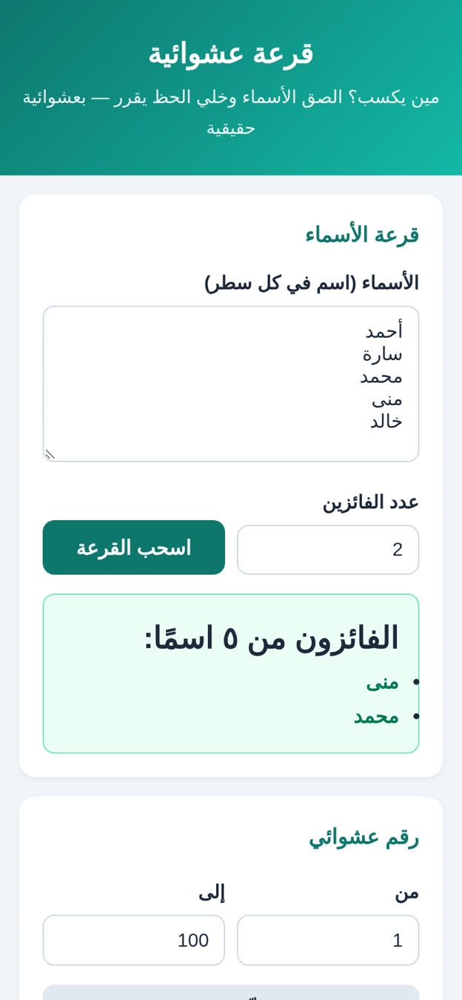

# Random Picker | قرعة عشوائية

A fair draw with true randomness: paste a list of names and pick one or more winners without repeats, or roll a random number in any range. Arabic interface.

**Live app:** https://abood-ayman.github.io/random-picker-ar/

**LinkedIn:** [Project entry](https://www.linkedin.com/in/abdullah-ayman-1678b737b/details/projects/)

This is a personal project, built with AI tools.

## Features
- Pick one or more winners from a name list (no repeats)
- Random number in any range you set (from - to)
- True randomness from your browser's crypto generator, not rough approximations
- Names never leave your device: the draw happens entirely in front of you

## Privacy
Everything runs in your browser. No data is stored or sent anywhere.

## Run locally
Open `index.html` in any browser. It is a single static page with no dependencies.

## Status
Stable.

## Copyright
MIT License - Copyright (c) 2026 Abdullah Ayman.
